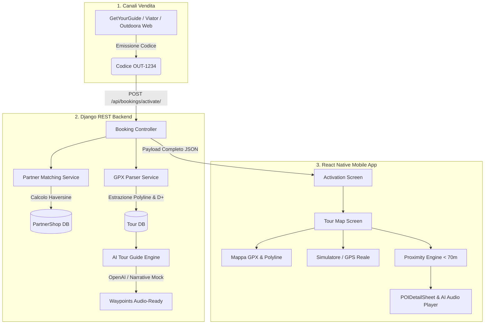
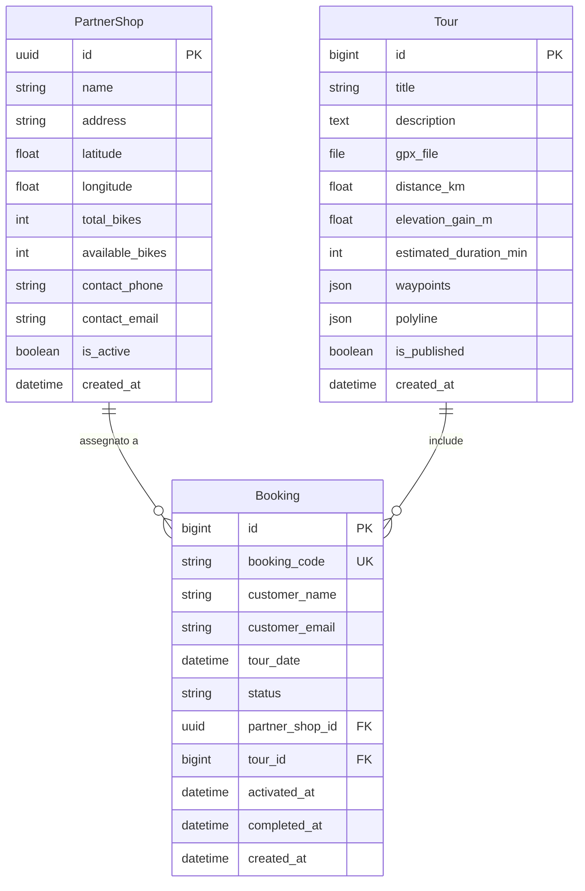

# 📖 Documentazione Ufficiale: Outdoora Rider & Partner Core

> **Versione**: 1.0.0 (MVP)  
> **Autore**: Senior Full Stack Team (Django & React Native)  
> **Data di Rilascio**: Novembre 2026  
> **Stato**: Pronto per Staging & Produzione

---

## 1. Visione di Progetto e Architettura di Sistema

**Outdoora Rider & Partner Core** è una piattaforma digitale integrata concepita per la gestione, arricchimento e fruizione di itinerari cicloturistici intelligenti.

Il sistema unifica tre attori fondamentali:
1. **Piattaforme di Prenotazione (OTA / Viator / GetYourGuide / Sito Diretto)**: generano codici di riscatto (es. `OUT-1234`).
2. **Negozi di Noleggio & Assistenza Partner (`PartnerShop`)**: forniscono le e-bike/bici fisiche e l'assistenza tecnica nei punti strategici del territorio.
3. **Cicloturista (`Rider`)**: sblocca il tour da mobile, visualizza la traccia GPX su mappa interattiva, riceve telemetria in tempo reale e ascolta le guide culturali audio generate dall'Intelligenza Artificiale lungo il tracciato.



---

## 2. Modello Dati e Diagramma ER (Entity-Relationship)

Il database relazionale (SQLite in locale, compatibile con PostgreSQL in produzione) è strutturato attorno a tre entità chiave:



### Struttura Dati JSON dei Waypoints (`Tour.waypoints`)
```json
[
  {
    "id": 1,
    "name": "Piazza Mazzini & Bellagio Lakefront",
    "latitude": 45.9880,
    "longitude": 9.2625,
    "elevation": 215.0,
    "notes": "Start point near the ferry terminal. Bike partner hub and briefing area.",
    "category": "BIKE_HUB",
    "ai_guide": "Benvenuto a Bellagio, la 'Perla del Lario'! Ti trovi proprio dove i due rami del lago si separano verso Como e Lecco..."
  }
]
```

---

## 3. Servizi di Business Logic (`/backend/core/services/`)

### 3.1. Parser GPX (`gpx_parser.py`)
Utilizza la libreria specializzata `gpxpy` per analizzare i file `.gpx` XML caricati dall'amministratore:
* **Estrazione Polyline**: normalizza le coordinate `[{latitude, longitude, elevation}]` a 6 cifre decimali WGS84, pronte per il render istantaneo da mobile senza ricalcoli pesanti lato client.
* **Calcolo Distanza 2D/3D**: sfrutta la lunghezza sferica cumulativa via formula di Haversine.
* **Calcolo Dislivello Positivo (D+)**: somma differenziale degli aumenti di quota `pt[i].ele - pt[i-1].ele > 0`, ignorando perdite di quota e rumore GPS.
* **Stima Durata Ciclistica**: calcolata su una velocità media di crociera di 18 km/h su falsopiano, con penalità di 8 minuti per ogni 100m di salita verticale accumulata.
* **Categorizzazione Euristica POI**: classifica automaticamente le tappe in base ai termini rilevati nei metadati:
  * `VIEWPOINT` (belvedere, panorama, lago, terrazza, cima)
  * `MONUMENT` (chiesa, santuario, villa, castello, museo)
  * `REFRESHMENT` (rifugio, bar, ristoro, trattoria, fontana)
  * `BIKE_HUB` (noleggio, officina, partner, ricarica)

### 3.2. Matching Geospaziale Partner (`partner_matching.py`)
Assicura che ad ogni prenotazione venga abbinato il centro noleggio più idoneo:
1. Ricerca tutti i `PartnerShop` con `is_active=True` e `available_bikes >= 1`.
2. Calcola la distanza dal punto iniziale del tour (`Tour.start_point`).
3. Seleziona il partner a distanza minima ed esegue l'assegnazione all'interno di una transazione atomica (`transaction.atomic()`).

### 3.3. Guida Culturale AI Audio-Ready (`ai_tour_guide.py`)
Fornisce ai ciclisti narrazioni di qualità professionale lungo il percorso:
* **Modalità OpenAI Live**: interroga i modelli GPT (`gpt-4o-mini`) con `response_format={"type": "json_object"}`. Il prompt è istruito per restituire un testo in stile podcast (35-50 parole per tappa) che include aneddoti storici del luogo e un consiglio pratico di guida/sicurezza.
* **Modalità Mock Intelligente**: se `MOCK_OPENAI=True` in `.env`, un motore narrativo integrato arricchisce i waypoint con descrizioni verificate del Lago di Como e delle Prealpi Lombarde, consentendo test immediati a costo zero.

---

## 4. Specifiche API REST (`/api/`)

Tutti gli endpoint rispondono con intestazioni CORS permissive configurate per lo sviluppo mobile ed accettano/restituiscono `application/json`.

### 4.1. Attivazione Prenotazione da Mobile
* **Rotta**: `POST /api/bookings/activate/`
* **Scopo**: Riscattare il codice prenotazione e sbloccare l'itinerario.
* **Request Body**:
  ```json
  {
    "booking_code": "OUT-1234"
  }
  ```
* **Response 200 OK**:
  ```json
  {
    "message": "Tour 'Lake Como Scenic Ridge: Bellagio to Ghisallo' attivato con successo! Buona pedalata.",
    "booking": {
      "id": 1,
      "booking_code": "OUT-1234",
      "customer_name": "Mario Rossi",
      "customer_email": "mario.rossi@example.com",
      "tour_date": "2026-11-11T13:30:00Z",
      "status": "IN_PROGRESS",
      "activated_at": "2026-11-11T11:58:00Z",
      "partner_shop": {
        "id": "c8567554-1521-4f90-a54d-d779fdfd7cfb",
        "name": "Bellagio E-Bike Experience",
        "address": "Lungolago Europa 14, 22021 Bellagio (CO)",
        "latitude": 45.9875,
        "longitude": 9.262,
        "available_bikes": 11,
        "contact_phone": "+39 031 950123"
      },
      "tour": {
        "id": 1,
        "title": "Lake Como Scenic Ridge: Bellagio to Ghisallo",
        "distance_km": 9.31,
        "elevation_gain_m": 605.0,
        "estimated_duration_min": 79,
        "waypoints": [ ... ],
        "polyline": [
          {"latitude": 45.988, "longitude": 9.2625, "elevation": 215.0},
          ...
        ]
      }
    }
  }
  ```
* **Response 404 Not Found**: Codice prenotazione inesistente.
* **Response 400 Bad Request**: Prenotazione precedentemente annullata.

### 4.2. Generazione Guida AI On-Demand
* **Rotta**: `POST /api/tours/{id}/generate-guide/`
* **Request Body**:
  ```json
  {
    "force_mock": false
  }
  ```
* **Response 200 OK**: Restituisce la lista aggiornata dei waypoints con il campo `ai_guide`.

### 4.3. Ricalcolo Traccia da GPX
* **Rotta**: `POST /api/tours/{id}/reparse-gpx/`
* **Response 200 OK**: Ricalcola polyline, km e D+ preservando le guide audio esistenti.

### 4.4. Completamento Corsa
* **Rotta**: `POST /api/bookings/{id}/complete/`
* **Response 200 OK**: Transiziona lo stato in `COMPLETED` e salva il timestamp `completed_at`.

---

## 5. Architettura Applicazione Mobile (`/mobile`)

L'applicazione React Native è progettata secondo il pattern **Single State Store** basato su React Context (`TourContext`):

```
mobile/src/
├── context/TourContext.tsx        # Stato globale: booking, tour, rider, simulator, POI
├── services/
│   ├── api.ts                     # Connessione Fetch a DRF con timeout e fallback host
│   └── speech.ts                  # Sintesi vocale multipiattaforma (Web Speech / Native)
├── screens/
│   ├── ActivationScreen.tsx       # Onboarding e riscatto codice
│   └── TourMapScreen.tsx          # Navigatore e orchestratore HUD
├── components/
│   ├── MapViewWrapper.tsx         # Polyline GPX e marker interattivi
│   ├── StatsHeader.tsx            # Telemetria (quota, velocità, km, partner)
│   ├── SimulationControls.tsx     # Player simulazione GPS
│   └── POIDetailSheet.tsx         # Scheda POI e riproduttore guida audio
└── utils/distance.ts              # Formule Haversine e rilevamento prossimità (<70m)
```

### 5.1. Rilevamento Prossimità Ciclista (< 70m)
La funzione `findNearbyWaypoint(rider, waypoints, 70)` calcola a ogni ciclo la distanza euclidea sferica tra le coordinate correnti del ciclista e ogni POI del tour. Quando la distanza scende sotto i 70 metri:
1. Viene emesso l'evento di prossimità.
2. Si apre automaticamente la card `POIDetailSheet`.
3. Il waypoint viene registrato come `visitato` per la statistica finale.

### 5.2. Riproduzione Audio & Sintesi Vocale (`SpeechService`)
Il servizio [`speech.ts`](file:///c:/Users/giuse/OneDrive/Desktop/TrailSync_Ride/mobile/src/services/speech.ts) supporta l'ascolto hands-free per il ciclista con auricolari:
* In ambiente browser/web utilizza la **Web Speech API** nativa (`window.speechSynthesis`) con voce italiana (`it-IT`).
* In ambiente mobile nativo (Expo Go o standalone) sfrutta l'engine vocale di sistema.
* Sincronizza visivamente una barra d'onda animata e un contatore di durata (`0:15 / 0:45`).

---

## 6. Configurazione & Variabili d'Ambiente

### Backend (`backend/.env`)
```ini
# Core Django
SECRET_KEY=outdoora-super-secret-key-change-in-production-2026
DEBUG=True
ALLOWED_HOSTS=*
CORS_ALLOW_ALL_ORIGINS=True

# OpenAI Configuration
# Se True, genera narrazioni contestualizzate locali senza bisogno di chiavi o quote a pagamento.
MOCK_OPENAI=True
OPENAI_API_KEY=sk-...
OPENAI_MODEL=gpt-4o-mini
```

### Mobile (`mobile/.env`)
```ini
# URL Base del server Django
# Per Web / iOS Simulator: http://localhost:8000
# Per Android Emulator: http://10.0.2.2:8000
# Per Expo Go su telefono fisico: http://IP_LOCALE_DEL_TUO_PC:8000 (es. http://192.168.1.150:8000)
EXPO_PUBLIC_API_URL=http://localhost:8000
```

---

## 7. Django Admin: Guida Operativa

Il pannello amministrativo ([http://127.0.0.1:8000/admin/](http://127.0.0.1:8000/admin/)) include funzionalità avanzate di gestione flotta e percorsi:

* **Gestione Partner Shop**:
  * Badge colorati per lo stato della flotta (Verde: >3 bici disp., Arancione: <3 bici, Rosso: 0 bici).
  * Coordinate WGS84 verificate per il matching geospaziale.
* **Gestione Tour**:
  * Azione in blocco: *“🔄 Ricalcola e ri-parsa la traccia GPX”*.
  * Azione in blocco: *“🤖 Genera / Rigenera Guida AI per tutti i POI”*.
  * Anteprima HTML navigabile dei contenuti turistici e delle narrazioni audio create per ciascun waypoint.
* **Gestione Prenotazioni**:
  * Azione: *“🚲 Assegna automaticamente partner più vicino”*.
  * Azione: *“🟢 Attiva corsa (In Corso)”*.
  * Azione: *“🏁 Segna come Completata”*.

---

## 8. Checklist di Produzione & Scalabilità

Per il passaggio alla fase Enterprise/Production si raccomandano i seguenti step:
1. **Database PostGIS**: Sostituire SQLite con PostgreSQL + estensione `PostGIS` (`django.contrib.gis.db.models.PointField` e query spaziali `ST_DWithin` indicizzate GiST).
2. **Object Storage**: Configurare AWS S3 o Cloudflare R2 per i file `.gpx` tramite `django-storages`.
3. **Code Asincrone**: Spostare l'arricchimento OpenAI su Celery + Redis per tour con oltre 50 POI.
4. **Webhooks OTA**: Implementare endpoint webhook dedicati per l'ascolto delle notifiche di acquisto da GetYourGuide e Viator.
